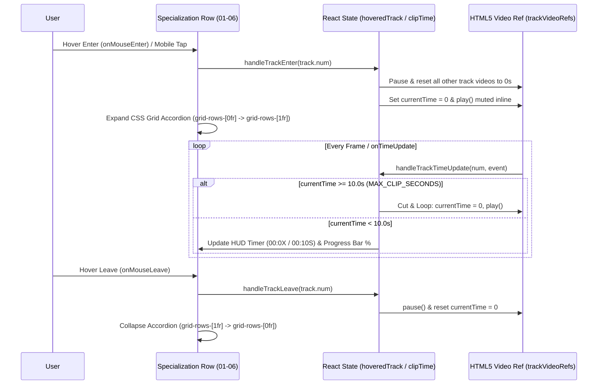

# CITEMAS Portal — System Architecture & Dynamic UI/UX Design

> [!NOTE]
> **CITEMAS (College of Information Technology Education Multimedia Arts System)** is a full-stack creative studio portal built with **Next.js 16 (App Router)**, **React 19**, **Tailwind CSS v4**, **Framer Motion 14**, **Three.js (WebGL)**, **MongoDB/Mongoose**, and **Cloudinary**.

---

## 1. High-Level System Architecture

```mermaid
flowchart TD
    subgraph Client["Client Layer (React 19 + Next.js App Router)"]
        Layout["RootLayout (app/layout.tsx)"]
        Nav["Fixed Glass Navbar (components/Navbar.jsx)"]
        Spine["ScrollSpine Telemetry HUD (components/ScrollSpine.jsx)"]
        BG["Adaptive Background (components/background.jsx)"]
        Hero3D["Three.js WebGL 3D Centerpiece (public/citemas-logo-3d.html)"]
        VideoEngine["10s Cut Hover Video Engine (app/page.tsx)"]
        Pages["Portal Pages (Dashboard, Events, Portfolio, Applications, Admin)"]
    end

    subgraph State["Client State & Theme Engine"]
        AuthCtx["AuthContext (lib/AuthContext.tsx)"]
        ThemeVars["CSS Custom Properties Dark/Light (app/globals.css)"]
        ToastCtx["Toast Notification System (components/Toast.jsx)"]
    end

    subgraph API["Serverless API Layer (app/api/*)"]
        AuthAPI["/api/auth/* (JWT + bcrypt)"]
        AppAPI["/api/applications/* (Org & Adviser Flows)"]
        PortAPI["/api/portfolio/* (Cloudinary Upload + Showcase)"]
        EventAPI["/api/events/* (Spatial Events & RSVPs)"]
        UserAPI["/api/users/* & /api/officers (RBAC Roster)"]
        AdminAPI["/api/achievements & /api/activity (Audit Logs)"]
    end

    subgraph Data["Persistence & Media Cloud"]
        Mongo[("MongoDB Atlas (Mongoose 9)")]
        Cloud[("Cloudinary CDN (Portfolio & Avatar Media)")]
        StaticVideos[("Local Static Media (public/videos/*.mp4)")]
    end

    Layout --> Nav
    Layout --> Spine
    Layout --> BG
    Layout --> Pages
    Pages --> Hero3D
    Pages --> VideoEngine
    VideoEngine --> StaticVideos
    Pages --> AuthCtx
    Pages --> ThemeVars
    Pages --> API
    API --> Mongo
    PortAPI --> Cloud
```



---

## 2. 3D WebGL Engine & Spatial Centerpiece Architecture

The 3D visual system is built natively with **Three.js** and procedural geometry rather than heavy external `.gltf` network downloads, ensuring fast load times and 60fps interaction.

### 2.1 Procedural 3D Logo (`public/citemas-logo-3d.html`)
- **File:** [`citemas-logo-3d.html`](file:///c:/Citemas/citemas/public/citemas-logo-3d.html#L1-L178)
- **Embedded Mode (`?embed`):** Loaded inside [`app/page.tsx`](file:///c:/Citemas/citemas/app/page.tsx#L513-L520) via `<iframe src="/citemas-logo-3d.html?embed" />`. Adding `?embed` activates transparent WebGL alpha clearing (`renderer.setClearColor(0x000000, 0)`) and hides standalone controls (`#hint`, `#dl`, `#exp`).
- **Procedural Geometry Construction:**
  - Traces **6 curved blades** (`blade(k)`) stacked along the Z-axis (`(5 - k) * 0.125`) plus a **Catmull-Rom spline ribbon** (`ribbon()`) extruded with `THREE.ExtrudeGeometry` (bevel segments, depth `0.07`).
  - **Custom Vertex Shader Coloring (`paint(g)`):** Computes per-vertex linear sRGB interpolation across 5 crimson stops (`#030000` → `#4a0408` → `#bf1219` → `#dc3a40` → `#e8666a`).
  - **PBR Clearcoat Material:** Uses `THREE.MeshPhysicalMaterial` (`roughness: 0.3`, `metalness: 0.2`, `clearcoat: 1.0`, `ACESFilmicToneMapping`) lit by a 4-point studio rig (Hemisphere light, key DirectionalLight, crimson rim light, and soft fill PointLight).
- **Interactive Physics & Inertia Loop:**
  - Supports **Pointer Drag Rotation** (`pointerdown`, `pointermove`, `pointerup`) with angular velocity damping (`vel *= 0.95`), pitch clamping (`[-0.6, 0.6]` rad), and automatic idle 360° yaw rotation after `1.2s` of inactivity.
  - **GLB Exporter:** Includes `THREE.GLTFExporter` to export the procedural mesh directly as a binary `citemas-logo.glb` asset when opened standalone.

### 2.2 Hero Mouse-Parallax & Smooth Scene Reveal (`app/page.tsx`)
- **Cursor Parallax (`handleHeroMouseMove`):** Normalizes cursor coordinates within `#hero` to `[-1, 1]` (`mouseOffset.x`, `mouseOffset.y`) in [`app/page.tsx`](file:///c:/Citemas/citemas/app/page.tsx#L102-L111).
  - The 3D centerpiece shifts with `translate3d(x * 16px, y * 12px, 0)`.
  - Three floating orbital photography cards (`/orgpic.jpg`, `/orgpic2.jpg`, `/orgpic3.jpg`) move at independent parallax depths (`24px`, `-18px`, `12px`) on the right side of the stage.
- **Zero-Jank Loading Handoff:** While the WebGL context initializes, [`CitemasLoader`](file:///c:/Citemas/citemas/components/CitemasLoader.jsx) displays the pulsing CITEMAS brand mark and cross-fades out (`duration-700`) once `onLoad` fires on the iframe (with a `3500ms` safety fallback timer).

---

## 3. Dynamic Video Showcase System (10-Second Cut & Hover Accordion)

Located in the **Card 2: Craft & Disciplines (`#specializations`)** section of [`app/page.tsx`](file:///c:/Citemas/citemas/app/page.tsx#L79-L118) and [`app/page.tsx`](file:///c:/Citemas/citemas/app/page.tsx#L614-L776).



### Key Engineering Decisions for the Video Engine
1. **DOM-Persistent Preloaded `<video>` Elements:**
   - Instead of mounting/unmounting `<video>` tags on hover (which causes a black flash and re-buffering delay), each `<video preload="metadata" muted playsInline>` stays mounted inside a CSS Grid row container (`grid-rows-[0fr]` → `grid-rows-[1fr]`).
   - The first frame is already decoded in GPU memory, so hover playback begins at `0.00s` with zero flicker.
2. **Strict 10-Second Cut Enforcement (`MAX_CLIP_SECONDS = 10`):**
   - **Dual-Layer Enforcement:** Uses both the HTML5 Media Fragment URI (`#t=0,10`) and a real-time `onTimeUpdate` listener (`handleTrackTimeUpdate`) that checks `if (vid.currentTime >= 10) { vid.currentTime = 0; vid.play(); }`.
3. **Adaptive Row Compaction:**
   - When `hoveredTrack` is active, non-hovered specialization rows automatically tighten their vertical padding (`py-3 sm:py-3.5 opacity-60`) so the expanded `h-36 sm:h-44 lg:h-48` video showcase fits inside the `86vh` sticky card without overflowing or clipping.
4. **Live Studio Telemetry HUD:**
   - Displays a pulsing red recording indicator, track-specific discipline tag (`DIGITAL STUDIO // REEL`, `SPATIAL CGI // 3D SHOWREEL`, etc.), real-time `00:0X / 00:10S CUT` counter, and a linear red-orange progress bar along the bottom edge.
5. **Mapped Video Assets (`public/videos/`):**
   - `01 — Digital Arts` → [`/videos/digital.mp4`](file:///c:/Citemas/citemas/public/videos/digital.mp4)
   - `02 — 3D Animation` (and default preview reel) → [`/videos/3d.mp4`](file:///c:/Citemas/citemas/public/videos/3d.mp4)

---

## 4. Dynamic UI/UX & Motion Architecture

### 4.1 400vh Sticky Card Stack Kinematics (`app/page.tsx`)
- **File:** [`app/page.tsx`](file:///c:/Citemas/citemas/app/page.tsx#L185-L212) and [`app/page.tsx`](file:///c:/Citemas/citemas/app/page.tsx#L350-L363)
- The landing page wraps 4 full-viewport `sticky top-0` sections (`#hero`, `#specializations`, `#telemetry`, `#leadership`) inside a `h-[400vh]` scroll track (`stackContainerRef`).
- A passive scroll listener computes a continuous `0.0 → 3.0` progress value and derives per-card recession values `[p0, p1, p2, p3]`:
  - **Depth Scale Transform:** `scale(${1 - cardProgress[i] * 0.08})` scales the underlying card down to `92%` as the next card slides over it.
  - **Depth Dimming Filter:** `filter: brightness(${1 - cardProgress[i] * 0.45})` dims the receding card by `45%` to create physical depth separation.

### 4.2 Scroll-Driven Starfield-to-Blueprint Crossfade (`app/page.tsx`)
- **File:** [`app/page.tsx`](file:///c:/Citemas/citemas/app/page.tsx#L316-L345)
- As the user scrolls from **Card 1 (Hero)** into **Card 2 (Specializations)**:
  - The 2-layer drifting CSS radial starfield (`starfield-layer-1`, `starfield-layer-2`) fades out via `opacity: Math.max(0, 1 - cardProgress[0] * 1.3)`.
  - Simultaneously, the technical blueprint grid fades in via `opacity: Math.min(1, cardProgress[0] * 1.2)`.
- On non-landing pages, [`components/background.jsx`](file:///c:/Citemas/citemas/components/background.jsx#L1-L24) renders a dedicated fixed 64px technical grid with ambient crimson glow.

### 4.3 Global ScrollSpine Telemetry HUD (`components/ScrollSpine.jsx`)
- **File:** [`components/ScrollSpine.jsx`](file:///c:/Citemas/citemas/components/ScrollSpine.jsx#L1-L203)
- Uses Framer Motion's `useScroll` and `useSpring` (`stiffness: 280, damping: 30`) to drive a vertical progress gauge along the right edge of the viewport (`00%` to `100%`).
- Combines `IntersectionObserver` with sticky-stack scroll math to dynamically update the active section readout (`HERO`, `SPECIALIZATIONS`, `TELEMETRY`, `LEADERSHIP`, `EVENTS`, `PORTFOLIO`, `FOOTER`).

### 4.4 Flash-Free Dual Theme Engine (Dark & Light Mode)
- **Files:** [`app/layout.tsx`](file:///c:/Citemas/citemas/app/layout.tsx#L32-L39), [`app/globals.css`](file:///c:/Citemas/citemas/app/globals.css#L3-L73), [`components/Navbar.jsx`](file:///c:/Citemas/citemas/components/Navbar.jsx#L30-L60)
- **Zero-FOUC Initialization:** An inline script in `<head>` reads `localStorage.getItem('citemas-theme')` before first paint and applies `.dark` or `.light` to `<html>`.
- **Tailwind v4 Custom Variant & Tokens:** Uses `@custom-variant dark (&:where(.dark, .dark *));` alongside semantic CSS variables (`--background`, `--foreground`, `--card-bg`, `--paper-glass`, `--line`, `--accent`) so every surface, modal, and glass border adapts between **Obsidian Dark (`#070305`)** and **Editorial Daylight (`#ffffff` / `#f3f4f6`)**.

### 4.5 Spatial Events & Leadership Carousels
- **Leadership Carousel ([`app/page.tsx`](file:///c:/Citemas/citemas/app/page.tsx#L173-L181)):** Auto-rotates active officers fetched from `/api/officers` every `5.5s`, pausing automatically when the user hovers over the card (`isCarouselPaused`) or when the browser tab is hidden (`document.hidden`).
- **Events Spatial Showcase ([`components/EventsSpatialShowcase.jsx`](file:///c:/Citemas/citemas/components/EventsSpatialShowcase.jsx#L1-L302)):** Cycles through past event archives every `6.0s` with dynamic radial glow palettes, L-shaped corner brackets ([`components/BracketPanel.jsx`](file:///c:/Citemas/citemas/components/BracketPanel.jsx)), and live telemetry badges ([`components/LivePing.jsx`](file:///c:/Citemas/citemas/components/LivePing.jsx)).

---

## 5. Full-Stack Codebase Directory & Module Map

```text
citemas/
├── app/
│   ├── layout.tsx                 # Root layout: AuthProvider, ToastProvider, Navbar, ScrollSpine, Background
│   ├── page.tsx                   # Landing page: 3D Hero, 10s Video Specializations, Telemetry, Leadership
│   ├── globals.css                # Tailwind v4 theme tokens, dark/light variables, plate-corner utilities
│   ├── dashboard/page.js          # Member & Staff Studio Command Center
│   ├── events/page.js             # Event calendar, RSVP system, and EventsSpatialShowcase
│   ├── portfolio/page.js          # Creative works gallery + Cloudinary upload modal
│   ├── applications/page.js       # Student org membership & Adviser approval workflows
│   ├── users/page.js              # Organization directory, role badges, and officer filters
│   ├── profile/                   # User profile view (page.js) & editor (edit/page.js)
│   ├── admin/                     # Admin control panel (page.js) & Activity audit log (activity/page.js)
│   ├── login/ & register/         # Glassmorphic auth screens with PHINMA ID & email validation
│   └── api/                       # Next.js Route Handlers (REST API)
│       ├── auth/                  # login, register, password-reset/{request,confirm}
│       ├── applications/          # CRUD, status checks, & admin approval/rejection
│       ├── events/                # Event CRUD & [id]/rsvp endpoints
│       ├── officers/              # Public & staff officer roster endpoint
│       ├── portfolio/             # Portfolio CRUD & /upload (Cloudinary integration)
│       ├── profile/               # Self-service profile & avatar update API
│       ├── achievements/          # Member achievement badges API
│       ├── activity/              # Admin audit trail API
│       └── users/                 # User management & role/officer assignment API
├── components/
│   ├── Navbar.jsx                 # Fixed h-16 glass header, theme toggle, mobile portal drawer
│   ├── ScrollSpine.jsx            # Right-hand spring-physics scroll progress & section indicator
│   ├── CitemasLoader.jsx          # Custom branded CITEMAS logo loader with dual orbital rings
│   ├── EventsSpatialShowcase.jsx  # Spatial archive showcase with corner brackets & telemetry
│   ├── AdminNotificationBell.jsx  # Real-time pending application & adviser notification dropdown
│   ├── BracketPanel.jsx           # Architectural container with L-shaped corner reticles
│   ├── FileUpload.jsx             # Drag-and-drop image uploader for portfolios & profiles
│   ├── Footer.jsx                 # Studio footer with sitemap and status telemetry
│   └── Toast.jsx                  # Global non-blocking notification toast system
├── lib/
│   ├── AuthContext.tsx            # Client auth state, JWT persistence, auto-hydration
│   ├── auth.js                    # Server JWT verification & token signing
│   ├── permissions.js             # Role hierarchy & officer position constraints
│   ├── validators.js              # Zod schemas (PHINMA email & Student ID regex [0-9]{2}-[0-9]{4}-[0-9]{4,7})
│   ├── specializations.js         # Canonical specialization definitions & color tokens
│   ├── mongodb.js                 # Cached Mongoose connection pool for serverless routes
│   └── logActivity.js             # Audit logging helper for administrative actions
├── models/
│   ├── User.js                    # User schema (roles, officerPosition, specialization, studentId, status)
│   ├── Application.js             # Membership application schema (motivation, portfolioLink, portfolioImages)
│   ├── Portfolio.js               # Creative work schema (mediaUrl, specialization, level, status)
│   ├── Event.js                   # Event schema (date, location, attendees RSVP list, image/images)
│   ├── Achievement.js             # Member awards & recognition schema
│   └── ActivityLog.js             # System-wide administrative audit log schema
└── public/
    ├── citemas-logo-3d.html       # Procedural Three.js WebGL 3D CITEMAS logo (embed + GLB exporter)
    ├── citemas-3d.html            # Standalone 900vh 3D scroll showcase
    ├── js/                        # Local Three.js (three.min.js) & GLTFExporter.js binaries
    └── videos/
        ├── digital.mp4            # 01 Digital Arts hover showcase video
        └── 3d.mp4                 # 02 3D Animation hover showcase video
```

---

## 6. Authentication, RBAC & Data Models

### 6.1 Role-Based Access Control (`lib/permissions.js`)
The platform enforces a multi-tier role hierarchy across both UI routes and API handlers:
- **`super_admin`:** Full system control, member deletion, officer assignment, adviser approval, and audit log inspection.
- **`teacher` / `adviser`:** Faculty oversight, application review, event management, and member directory access (Adviser registrations require admin approval before activation).
- **`officer`:** Student executives (`president`, `vice_president`, `secretary`, `treasurer` as single-holder unique roles; `pro`, `pio`, `events_director`, `creative_director`, `year_level_representative` as multi-holder roles).
- **`member` / `alumni`:** Approved organization members who can publish portfolio works, RSVP to events, and browse the member roster.
- **`applicant` / `user`:** Newly registered PHINMA students who can submit membership applications with portfolio links and uploaded artwork samples.

### 6.2 Validation & Security (`lib/validators.js` & `lib/auth.js`)
- **PHINMA Institutional Validation:** Enforces `@phinmaed.com` email domains and flexible cohort Student ID formatting (`^\d{2}-\d{4}-\d{4,7}$`) supporting college, high school, and grade school PHINMA IDs.
- **Stateless JWT Auth:** Signed tokens (`lib/auth.js`) verified on protected API routes with automatic client hydration via [`lib/AuthContext.tsx`](file:///c:/Citemas/citemas/lib/AuthContext.tsx).

